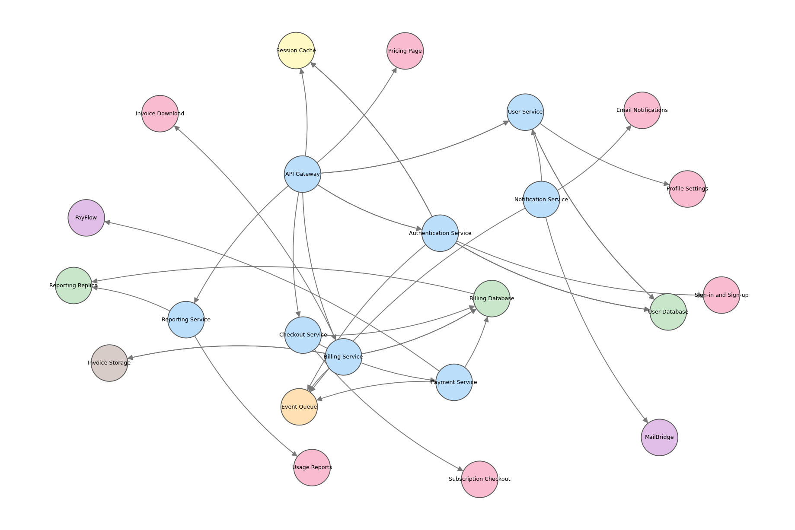
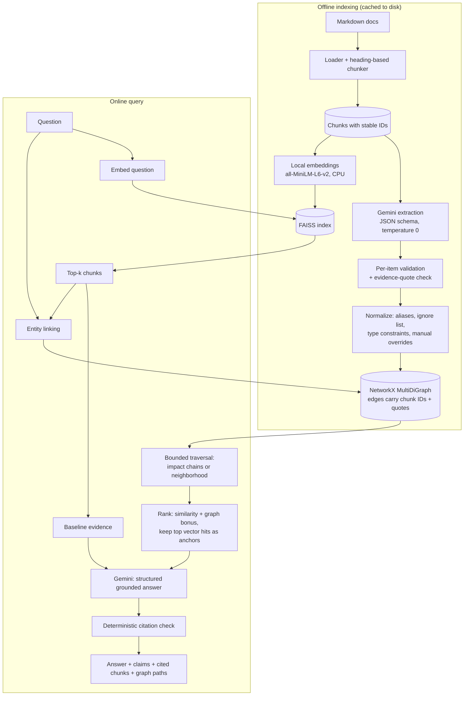

# GraphTrace

**Explainable GraphRAG over technical documentation, built to be compared against plain vector RAG.**

GraphTrace answers questions about a fictional SaaS platform's architecture docs. It retrieves evidence two ways, ordinary vector search and vector search plus a knowledge graph, then generates a grounded, cited answer from each so the two can be evaluated on the same questions.

> **Status: work in progress.** The ingestion, extraction, graph, retrieval and answering pipelines are built and have been run on real data. The **evaluation study** and the **Streamlit interface** are not done yet, so this README contains **no accuracy or "GraphRAG beats RAG" claims**. Those will appear only after they are measured. See the [roadmap](#roadmap).

## The knowledge graph



*23 entities and 38 relationships extracted by an LLM from 8 documents. Node colors: blue = service, green = database, yellow = cache, orange = queue, brown = object storage, purple = external provider, pink = user-facing feature.*

Reading the picture:

- **Arrows show who acts on what, not data flow.** A consumer is the source of a `CONSUMES_FROM` edge, so Notification Service points at Event Queue even though messages flow the other way.
- Doubled lines between two nodes are parallel edges with different relation types (for example the API Gateway both `CALLS` and `ROUTES_TO` the Authentication Service).
- This quick matplotlib render is a sanity check. It omits edge labels, and some nodes overlap. The planned UI will draw labeled subgraphs.

## What makes it different from basic RAG

| | Baseline RAG | GraphRAG (this project) |
|---|---|---|
| Finds evidence by | Semantic similarity to the question | Semantic similarity **plus** structural links between documented components |
| Good at | "How does X work?" | "What is connected to X, and through what chain?" |
| Weak at | Facts spread across documents that don't share wording | Extraction errors, noisy neighbors, simple lookups |
| Shows | Source chunks | Source chunks **and the graph paths** that led to them |

Both pipelines share the same index, the same answer generator and the same prompt rules. Only evidence gathering differs, so a comparison isolates the effect of the graph.

## Architecture



## What is implemented

- **Knowledge base:** 8 fictional "Lumio" architecture documents (services, APIs, databases, queues, failure scenarios, data flows), deliberately written with multi-hop chains, fallbacks, public routes that skip authentication, partial failures, and facts that are simply absent.
- **Chunking:** heading-based, no overlap, size cap with paragraph/sentence/hard-cut fallbacks, deterministic IDs like `authentication_service#04`.
- **Extraction:** Gemini returns schema-constrained JSON, validated item by item with Pydantic. Raw responses are cached on disk (keyed by prompt version, model and chunk text), so the graph is reproducible and re-runs cost no API calls.
- **Normalization:** alias merging, an ignore list for non-entities, per-relation **type constraints**, and a small list of documented manual edge corrections. Duplicate edges merge with all their evidence.
- **Graph:** NetworkX `MultiDiGraph`. Every edge retains source chunk IDs and the supporting quotes. An integrity check validates types, provenance and chunk references.
- **Traversal:** bounded, cycle-safe neighborhood search, shortest connections between entities, and "what may depend on X" impact chains.
- **Retrieval:** local sentence-transformers embeddings, exact FAISS search, and the two pipelines described above.
- **Answering:** the model must return atomic claims marked `DIRECT` or `INFERENCE`, each with chunk citations. Code then checks every citation and graph-path ID against what was actually supplied, so invented citations are recorded instead of shown as support.

## Results so far (measured)

These are **pipeline statistics from one run on this repo's data**, not an evaluation of answer quality.

| Stage | Result |
|---|---|
| Documents / chunks | 8 / 43 (chunk length 116 to 569 characters) |
| Extraction | 43 API calls with `gemini-3.1-flash-lite`, 92 raw relationships, 0 rejected items, evidence quote found verbatim in the source chunk for 92 of 92 |
| After deduplication | 51 distinct (source, relation, target) edges |
| After normalization | **23 entities, 38 edges**; 18 items dropped (7 non-entity names, 8 edges touching them, 2 manual corrections, 1 type-constraint violation) |
| Entity types | 8 service, 7 feature, 3 database, 2 external provider, 1 each of cache, queue, storage |
| Relation types | WRITES_TO 8, SERVES 7, CALLS 6, READS_FROM 6, ROUTES_TO 5, PUBLISHES_TO 2, CONSUMES_FROM 2, FALLS_BACK_TO 1, REPLICATES_TO 1 |
| Graph integrity | OK (no errors) |
| Vector search | 384-dimension embeddings; a query took about 9 to 11 ms including embedding the question |

### Early observations (informal, single runs, not benchmarks)

1. **Plain vector search misses part of a multi-hop question.** For *"If the authentication service fails, which features are affected?"* the top hit was the Session Cache outage chunk, because it shares the words "Authentication Service". The chunk about an actual authentication outage ranked 3rd, and no top-5 chunk contained the feature-to-service mapping. This motivated the graph.
2. **Vector search also ignores negation.** For *"What happens if the Session Cache is down?"*, a chunk stating that the User Service does **not** use the Session Cache ranked 3rd.
3. **Both pipelines refused to guess an absent fact.** Asked what programming language the Billing Service is written in, both returned `sufficient_evidence: false` with no invented claims. GraphRAG pulled in three extra chunks about the Billing Service that were irrelevant to the question, a small example of graph expansion adding noise.

The evaluation (below) exists to replace observations like these with measurements.

## Design decisions

- **Graph direction is documented, not assumed.** Edges follow the grammar of the source text (`A CALLS B`, consumers are the source of `CONSUMES_FROM`). For impact analysis a separate *dependency view* decides who may rely on whom: `ROUTES_TO` and `SERVES` reverse (a feature depends on its service), `FALLS_BACK_TO` is excluded by default because a fallback means tolerance, and a chain that has crossed a gateway routing step may only continue to user-facing features.
- **Paths are evidence of a documented dependency, never proof of failure.** The answer prompt forbids "will fail" unless the text states the actual behavior, and tells the model to look for bypass or fallback statements before listing a component as affected.
- **Extraction is validated three ways:** schema (Pydantic), provenance (the LLM never supplies `chunk_id`; our code does), and a deterministic check that each evidence quote appears in its chunk. A quote check catches fabrication but not misattribution, which is why type constraints and manual overrides also exist.
- **Prompt injection:** document text and questions are wrapped in delimiter tags, the system prompt declares them untrusted data, and the tag characters inside them are neutralized.
- **Same generator, same prompt, same index for both pipelines**, so differences come from retrieval.
- **Ranking is transparent:** cosine similarity plus a small bonus for chunks that back a graph path, with the top two vector hits always kept as anchors. The bonus values are heuristics, to be tested by the evaluation rather than assumed to help.
- **Local-first and cheap:** CPU embeddings, an in-memory graph, and a free-tier Gemini model. Requests are throttled to a configured requests-per-minute, retried with backoff, and a quota-exhausted error with a long retry hint stops immediately instead of waiting.

### Why NetworkX and not a graph database

The graph has about 23 nodes and 38 edges and fits in memory, and NetworkX needs no server, so the project runs from a fresh clone. A graph database such as Neo4j would be the right choice with a much larger graph, persistence with concurrent writes, or a need for a query language (Cypher) and indexes. At this scale it would add operational weight without improving the retrieval being studied.

## Setup (Windows PowerShell)

Tested on Windows with Python 3.10.11. The package requires Python 3.10 or newer.

```powershell
git clone <your-repo-url>
cd graphtrace
python -m venv .venv
.\.venv\Scripts\Activate.ps1
pip install -r requirements.txt
Copy-Item .env.example .env
notepad .env
```

If activation is blocked, run `Set-ExecutionPolicy -Scope CurrentUser -ExecutionPolicy RemoteSigned` once.

Set in `.env`:

```dotenv
GEMINI_API_KEY=your-key          # from https://aistudio.google.com/apikey ; never commit .env
GEMINI_MODEL=gemini-3.1-flash-lite
GEMINI_RPM=12                    # keep at or below your model's real requests-per-minute
```

Free-tier limits differ **per model and per account**. Check yours at https://aistudio.google.com/rate-limit before choosing. In the author's account, one model allowed only 20 requests per day (too few for 43 extraction calls) while a "flash-lite" model allowed 500.

### Run the pipeline

```powershell
python scripts\check_gemini.py          # verify key, list models, one tiny call
python scripts\extract_graph.py         # 43 Gemini calls the first time, then cached
python scripts\inspect_extractions.py   # inventory of cached extractions (no API calls)
python scripts\build_graph.py           # normalize into the graph, run integrity checks
python scripts\visualize_graph.py       # writes reports\graph.png and graph.dot
python scripts\build_vectors.py         # local embeddings + FAISS index
python scripts\search_chunks.py "What happens if the Session Cache is down?"
python scripts\ask.py "If the authentication service fails, which user-facing features could be affected?"
pytest
```

`ask.py` runs both pipelines and prints answers, claims with citations, evidence chunks, graph paths and latency. Use `--method baseline` or `--method graphrag` for one.

## Project structure

```
data/docs/                     Fictional Lumio architecture documents (source of truth)
data/entity_aliases.json       Aliases, ignore list, documented manual edge corrections
scripts/                       Pipeline entry points (see "Run the pipeline")
src/graphtrace/
  config.py                    Environment-driven settings and paths
  models.py                    Pydantic models: chunks, extraction, graph data, answers, results
  ingestion/                   Loader and chunker
  extraction/                  Prompt, validation, cached extractor, normalizer
  generation/                  Gemini client, answer prompt, answerer with citation checking
  graph/                       Builder, bounded traversal, integrity checks, DOT export
  retrieval/                   Embedder, FAISS index, entity linker, baseline and graph retrievers
  pipeline.py                  Loads everything and exposes one ask() entry point
tests/                         pytest suite
reports/                       Generated graph image (evaluation reports will go here)
```

## Testing

`pytest` currently runs 36 unit tests covering the loader, chunker, a content-level check of the knowledge base, extraction validation, the extraction cache (hits, invalidation, corruption, no caching of invalid JSON), config, and quota-hint parsing. The LLM is replaced by a fake client, so tests make no API calls. Tests for normalization, traversal (cycles, disconnected nodes), the entity linker, graph retrieval and citation validation are on the roadmap.

## Known limitations

- **Small, synthetic, self-authored corpus.** Results here say little about real-world documentation.
- **Extraction is imperfect and was partly corrected by hand.** Review of the extracted graph found two wrong edges that passed the quote check (a response misread as a call, and a reversed fallback); both are recorded as explicit overrides with reasons in `data/entity_aliases.json`. Extraction precision and recall were checked by manual review of one run, not measured systematically.
- **Events are not graph nodes.** The graph cannot say that the Billing Service consumes only `payment.completed`; that detail survives only in evidence quotes and source chunks.
- **The graph encodes who connects to whom, not what happens when something fails.** Timeouts, retries, caches and fallbacks live in the text. Graph paths therefore over-approximate impact (the Pricing Page is linked to the API Gateway even though public routes skip authentication), which the answer prompt must correct from the source chunks.
- **A displayed path can cite a chunk that did not make the evidence set**, so its supporting text is unavailable to the generator.
- **The alias and ignore lists are hand-maintained** and tuned to this corpus.
- **Quote verification catches fabricated evidence, not misattributed evidence.**
- **LLM output is not perfectly deterministic** even at temperature 0, which is why extraction responses are cached.

## Roadmap

- [x] Knowledge base, loader, chunker
- [x] Structured extraction with validation, caching, normalization
- [x] Knowledge graph, traversal, integrity checks, visualization
- [x] Local embeddings and FAISS retrieval
- [x] Baseline RAG and GraphRAG with grounded, cited answers (run on a small number of questions so far)
- [x] **Evaluation:** about 20 labeled questions (direct, relationship, multi-hop, cross-document, insufficient-evidence, misleading); Recall@k, citation validity, unsupported-claim rate, answer correctness (LLM judge on a separate model, reported separately from deterministic metrics), and latency; baseline at k=5 and k=8 plus GraphRAG; a reproducible report with measured numbers, including where GraphRAG loses
- [ ] Streamlit interface: answers, evidence, highlighted graph paths, method comparison, metrics dashboard
- [ ] Tests for normalization, traversal, linking, retrieval and citation validation; malformed-input and failure-path tests
- [ ] Clean-clone verification, pinned dependencies, demo workflow and screenshots

## Security notes

API keys are read from environment variables, `.env` is git-ignored, and `.env.example` documents the variables. Document and question text is treated as untrusted data in every prompt.
